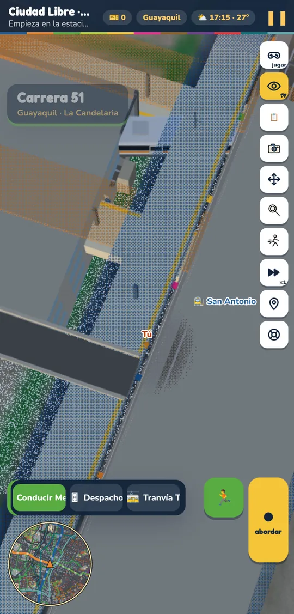
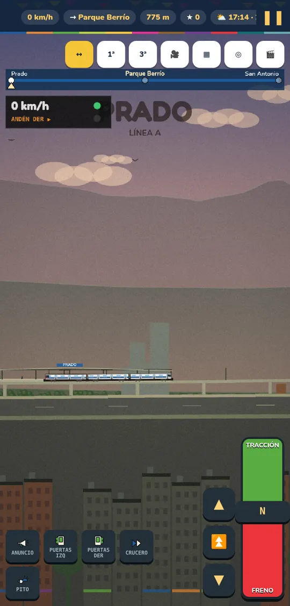
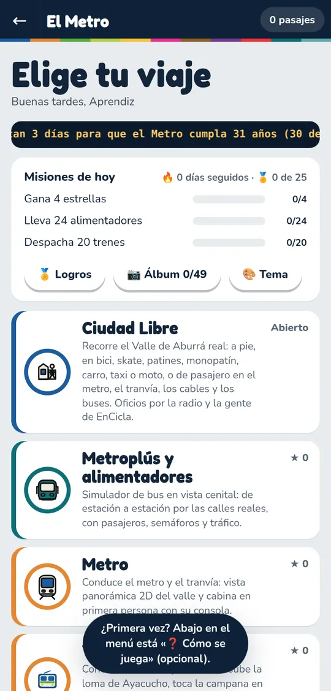
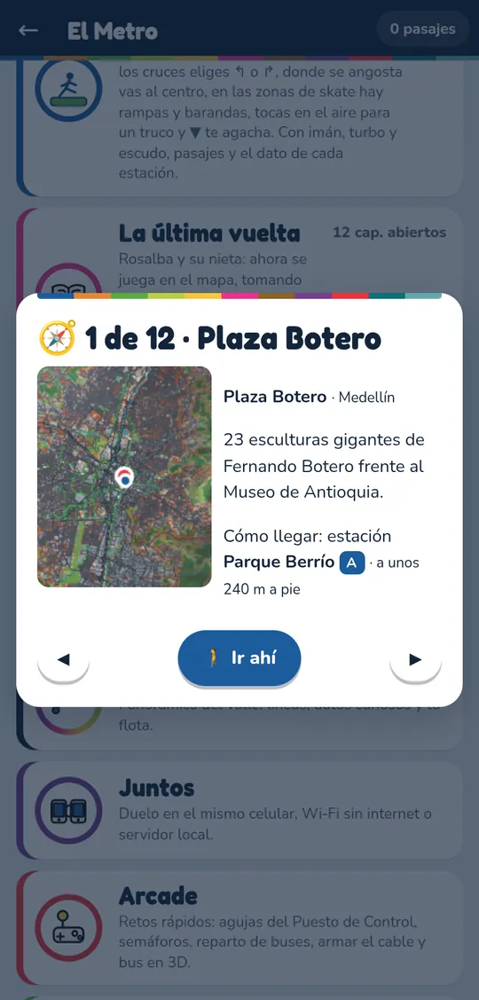

# Auditoría crítica y forense · El Metro (`MetroZero` v3.12.0)

> **Fecha:** 27-nov-2026 · **Informe completo del ecosistema (los 5 productos):** [`motorcity/docs/AUDITORIA-CRITICA-2026-11-27.md`](https://github.com/juanfeliperico369-stack/motorcity/blob/main/docs/AUDITORIA-CRITICA-2026-11-27.md)
>
> **Metodología:** revisión directa de los 82 módulos en `src/js/`, `src/data/`, `tools/build.mjs`, `tools/test.mjs` y compilación + ejecución en Google Chrome 158 móvil (`412 × 860`, DPR 2, táctil, WebGL). Sin dar por cierto ningún `"0 errores"` de `docs/BITACORA.md`.

---

## 1. Evidencia visual real (`412 × 860`, v3.12.0)






Lo que experimenta cualquier jugador hoy nada más abrir El Metro 3.12.0:
1. **Ciudad Libre al entrar (`el-metro-libre.webp`):**
   - **Media pantalla cubierta por un tramado ajedrezado tipo estática de televisor** (`occluder fade` a 0,30 en `97d-cenital.js`), porque naces pegado al techo de la estación San Antonio.
   - **El resto del mundo alrededor es un vacío gris liso** sin calles pintadas legibles, sin árboles de avenida, sin semáforos, sin bancas, sin postes ni edificios reconocibles.
   - **El jugador es un punto naranja minúsculo (`Tú`)** encajonado contra una losa gris.
   - **10 botones blancos sin etiqueta apilados a la derecha** — y **13 de los 17 botones visibles miden `40×38 px`**, violando el mínimo táctil de `44×44 px`.
   - **Textos cortados en todo el HUD:** cabecera (`Ciudad Libre ·...` / `Empieza en la estaci...`) y barra inferior (`Conducir Me` / `Tranvía T`).
   - **276,5 MB de heap JS** en Chrome móvil (`1,3–1,4 FPS`, p95 `792–1.383 ms` en SwiftShader).
2. **Conduce el Metro (`el-metro-conduce.webp`):**
   - El cuadro negro del velocímetro (`0 km/h · ANDÉN DER`) **tapa la letra `P` de `PRADO`**.
   - El reloj arriba a la derecha se recorta contra el botón de pausa.
   - Siguen vivos **7 botones de cámara sin texto** (`↔`, `1ª`, `3ª`, `🎥`, `▦`, `◎`, `🎬`).
3. **Menú de modos (`el-metro-modos.webp`):**
   - La marquesina superior aparece recortada a izquierda y derecha (`tan 3 días para que el Metro cumpla 31 años (30 de`).
   - El aviso flotante inferior tapa la tarjeta del Tranvía de Ayacucho.
   - El modo **Turismo** ni siquiera está en la portada; está enterrado en la posición 8 del menú de 21 botones (`y = 1461 px`).

---

## 2. Bugs críticos verificados en código (todos pasaron `test.mjs 100` con `"0 errores"`)

1. **LA PAUSA ESTÁ 100 % ROTA EN TODO EL JUEGO (`src/js/25-game.js:28`):**
   ```js
   const t = now(), raw = Math.max(0, t - this.last), M = this.mode; this.last = t; let dt = M.substeps ? Math.min(.2, raw) : Math.min(.05, raw);   // 3.6: hasta 0,2 s (tiempo real hasta ~5 cuadros por segundo) if (this.paused) dt = 0;
   ```
   Un comentario `//` metido en la misma línea **comentó `if (this.paused) dt = 0;`**. Cuando tocas Pausa (`⏸`) o `Esc`, **la simulación, el reloj, los trenes y los oficios siguen corriendo a toda velocidad detrás del menú**.
2. **CAMINAR ESTÁ MEDIO COMENTADO (`src/js/36-libre.js:210`):**
   ```js
   const w0 = st.wv || 0; st.wv = w0 + (spd - w0) * (1 - Math.exp(-dt * (spd > w0 ? 11 : 16)));   // 3.1 · igual a cualquier ritmo de cuadros if (st.wv < .03) st.wv = 0; st.vf = st.wv; if (!st.wv) return;
   ```
   El mismo error `//`: `st.vf` jamás se actualiza al caminar, `st.wv` nunca baja a `0` y `walk()` jamás hace retorno temprano estando quieto.
3. **MULTIJUGADOR COOPERATIVO 100 % ROTO EN LOS 4 MODOS (`src/js/80-multi.js:109`):**
   ```js
   case 'act': if (Net.role === 'host' && Game.net && Game.net.kind === 'coop' && Game.mode && (typeof m.a === 'number' || (typeof m.a === 'string' && m.a.length <= 32))) Game.mode.act(Game.st, m.a); break;
   ```
   Todos los modos cooperativos (`40-rieles.js:182`, `45-metroplus.js:118-123`, `50-cable.js:49`) envían **objetos** (`{k:'sw',i}`, `{k:'x',i}`, `{k:'rot',i}`). El anfitrión bota el 100 % de las entradas del invitado.
4. **EL RESPALDO 2D, «MEDIR MI CELULAR» Y `tools/rendimiento-cenital.mjs` MIENTEN (`36-libre.js:43`, `96d-rendimiento.js:30,42`, `tools/rendimiento-cenital.mjs:22,33`):**
   `Libre.vista(st, v)` fija `v = 'cen3d'` incondicionalmente. Cuando el regulador baja a «2D» en un celular lento, muestra el aviso de 2D mientras sigue en 3D; y tanto `R.medir()` como el benchmark A/B del repo miden **`cen3d` dos veces** y etiquetan una corrida como `2d`.
5. **PELLIZCAR NO PUEDE LLEGAR A «CASI TERCERA PERSONA» (`96g-ladeo-mitades.js:210` vs `36-libre.js:39`):**
   `36-libre.js` pide `zoomU >= 3.6` para bajar a ~40°, pero `96g` sobrescribe `camGestos` y clampa el pellizco en `3.2`. Además la rotación `cyC` (`36-libre.js:670`) usa `* .06` por cuadro sin `dt`.
6. **APAGAR LA MÚSICA DEJA SONANDO LOS *HI-HATS* (`00-core.js:135,193`):**
   La percusión musical usa `Snd.noise(..., 3)` conectado a `Snd.sfxG` en lugar de `Snd.mus`. Apagar la música deja un *tsss-tsss* constante sobre el silencio; además `Music.timer` (`setInterval` de 60 ms) nunca se detiene cuando el guardián suspende el `AudioContext`.
7. **TURISMO TELETRANSPORTA SIN DESPEJAR NI PONER GUÍA (`97f-turismo.js:76-78`):**
   Al pulsar «🚶 Ir ahí», carga `'lb:ultimo'` (arrastrando tu vehículo viejo), sobreescribe `st.x = q.x; st.y = q.y` sin `VC.despeja` (puede meterse en un edificio/pilar), no mueve `st.cam` y **no marca ninguna guía hacia el sitio turístico**.

---

## 3. Arquitectura, parches y rendimiento

- **HTML único de 9,04 MiB (9.473.947 B):** `src/data/*` pesa **7,69 MiB (85,1 %)** — solo `edificios.js` son **4,46 MB** — y 82 archivos JS sin minificar suman 1,18 MB. **`motor-city/` (50 MB)** no entra al compilado (0 % en runtime).
- **Apilamiento extremo de parches:** `Libre.step` tiene **9 capas** (`97b → 97d → 96k → 96h → 96g → 96e → 37 → 36c → 36-libre`), `G3.draw` tiene **5 capas** (`97e → 97d → 96d → 22a → 22-gl`), `Menu.levels` tiene **3 limpiadores de `.lock` redundantes**, y `98-relevo-z1.js:26` deja un `setInterval(ubicar, 300)` eterno en todas las pantallas.
- **Parches no-op y duplicados:**
  - `96-arcade.js:58-65` y `96k-taller-bici.js:117` modifican `VEH.acc` que ni `38-bus.js` ni `36-libre.js` leen.
  - `38-bus.js:130` anuncia bono `×1,25` que nunca suma en `finish()`.
  - Existen **2 lanzadores de actividades distintos** (`36c` y `97b`), **2 controles crucero** (`acelFijo` y `crucero`), **3 simuladores de bus** (`38-bus`, `32-volante` y el oficio de Libre) y **2 modos historia de Rosalba** (`70-historia.js` y `37-trama.js`) con guardados separados.
- **Por qué `97e-ventana-por-partes.js` sigue dando tirones (~440–1.383 ms):**
  1. `22-gl.js:133-134` aún sube síncronamente un canvas `2048×2048` + `generateMipmap` en el cuadro de cambio.
  2. `22-gl.js:179-185` reconstruye la malla de terreno (20.000 `elevM`) y borra/crea VBOs de golpe.
  3. `97e:67` dispara un bucle de emergencia síncrono de hasta 200 pasos si te mueves rápido.
  4. `22a-gpt6-eon-3d-batch.js:32-47` asigna cientos de `new Float32Array(16)` cada cuadro.
- **Arte 3D roto y desperdiciado:**
  - **0 % de texturas IA en el mundo 3D** (los 585 KB de `arte.js` son solo retratos, íconos y tarjetas). `96i-arte-36.js` pide **16 PNGs que no existen** en `arte.js`.
  - `22-gl.js:236` bota los polígonos reales de edificios y dibuja cajas simples con ventanas de shader que se deforman en muros girados; `22-gl.js:262` **omite Plaza Botero, Pies Descalzos y Parque de las Luces**; `22-gl.js:215` ignora todos los árboles de avenidas; y **100 % de `28-taller-ciudad.js` y `28-taller-estacion.js` (donde sí hay modelos detallados) es código muerto jamás llamado en juego**.

---

## 4. Evaluación de tus pedidos (P1–P13) en El Metro

| Pedido | Estado real | Veredicto |
|---|---|---|
| **P1 · Mundo 3D cenital** | Cubos planos sin textura sobre un suelo pintado en 2D | **MAL** — feo, vacío y tapado por estática ajedrezada. |
| **P2 · Una sola cámara, eliminar las demás** | Solo bloqueó `Libre.vista`; dejó 5 radios zombis en Ajustes, 6–7 cámaras en 4 modos, Maqueta 2:1 viva y pellizco roto (`3.2 < 3.6`) | **MAL** |
| **P3 · Nada pintado en el suelo** | 0 semáforos, 0 postes, 0 bancas, 0 cebras, 0 árboles de avenidas, hitos planos sin agujas/cúpulas, `Bus` sigue 2D | **PÉSIMO** |
| **P5 · Mejores detalles y texturas** | 0 texturas en 3D + 16 PNGs faltantes en `96i` + `28-taller-ciudad` sin conectar | **PÉSIMO** |
| **P6 y P7 · Carga y fluidez** | Aún congela en swap de textura/terreno, sin paso fijo interpolado, caminar roto, 276 MB RAM | **MAL** |
| **P8 · Música al salir** | Suspende `AudioContext`, pero `Music.timer` sigue girando y los *hi-hats* suenan por SFX | **REGULAR** |
| **P10 · Controles personalizables + vertical/horizontal** | **0 % implementado** | **NO EXISTE** |
| **P13 · Modo turismo** | Folleto HTML de 13 pantallas + teletransporte con bug sin ruta | **MAL** |

---

## 5. Por qué NO es divertido y por qué `test.mjs 100` engañó al equipo

- **15+ modos a medio hacer sin un solo bucle redondo:** cambias de modo y cambian las cámaras, los controles, el arte y la calidad. Metrocable es casi un protector de pantalla; Puzle del Cable, Despacho y Metroplús son clones genéricos desconectados de Medellín; Ciudad Libre interrumpe al jugador con crónicas cada 20 s y pinchazos aleatorios (`40 %` al frenar en bici, `96k:132`).
- **`tools/test.mjs 100` es teatro de pruebas:** corre las 100 partidas con `EM.headless = true` (apaga WebGL, DOM, controles y audio), maneja con `auto: true` en vez de entradas humanas, llama `vista('1p')` y `'3p'` sin comprobar que cambió la cámara, y **nunca detectó Pausa rota, caminar roto ni Coop 100 % muerto**.

---

## 6. Cómo salvar a El Metro

1. **Arreglos de emergencia (1 hora):** quitar el `//` de `25-game.js:28` (Pausa) y `36-libre.js:210` (Caminar), arreglar `80-multi.js:109` (Coop), corregir el clamp `3.2 → 4.0` en `96g:210`, pasar los *hi-hats* a `Snd.mus`, y limpiar los 5 radios muertos en Ajustes.
2. **Poda de 15 modos a 3 pilares sólidos:**
   - **Conduce el sistema** (Metro, Tranvía con tráfico real en Ayacucho, Metrocable) con controles claros, sin texto encimado y con buena sensación de aceleración/frenado.
   - **Ciudad Libre 3D real** (borrando los 2 buses duplicados, los clones abstractos, los 10 botones sin etiqueta → máximo 4–5 botones claros, quitando la estática ajedrezada fea por transparencia real / recorte suave del techo y conectando `28-taller-ciudad` y `28-taller-estacion`!).
   - **La última vuelta (Rosalba)** unificada en **una sola** campaña jugable (eliminar la duplicidad `70-historia` vs `37-trama`) + **Modo Turismo jugable** (recorrido real en metro/cable/a pie con guía y sellos).
3. **Arquitectura y memoria:** borrar los 50 MB muertos de `motor-city/`, pasar `edificios.js`/`valle.js` a carga por sectores bajo demanda (bajar de 276 MB RAM a `< 60 MB`), usar paso fijo con interpolación y pruebas E2E reales sin `headless` engañoso.
