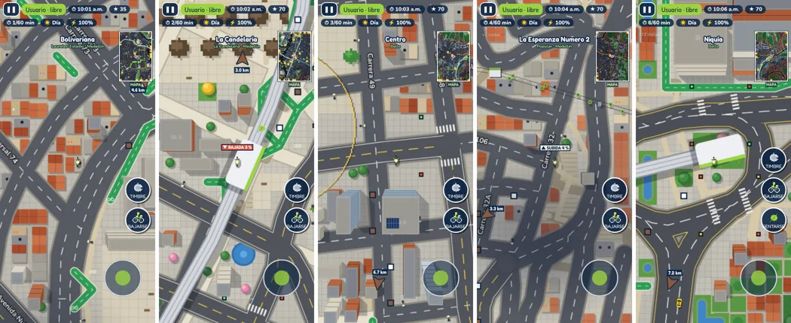
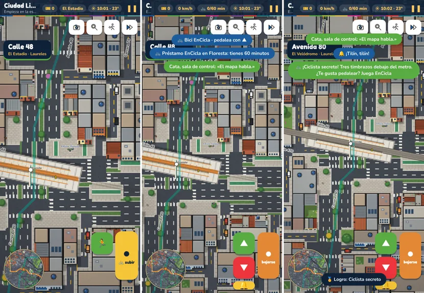

# Auditoría de Juega EnCicla v1.2.0, vista desde El Metro

**Fecha:** 17‑nov‑2026.

**Qué se revisó:**
- el HTML publicado (`juega-encicla.html`, 2,87 MB, idéntico al de `dist/` del repositorio);
- el repositorio `BicicletasUno`, rama de desarrollo `ccr-bed2d98a-uho2kr`: código, datos, herramientas y documentos;
- su propia auditoría, `docs/AUDITORIA-V1.2.md`.

**Para quién:**
- el autor;
- la IA que desarrolla Juega EnCicla: cada hallazgo trae su cifra y cómo reproducirla;
- el equipo de El Metro, que adoptó varias piezas.



## 1. Resumen
- **Sus pruebas son ciertas.** `node tests/run.js --n=100` dio:
  - 82 marcas ✓ y 0 ✗;
  - 100 partidas del bot sin fallas en 65 s;
  - 16,7 ms por cuadro con la CPU 4 veces más lenta;
  - el multijugador de 3 dispositivos pasa.
- **Carga:** 826 ms en PC, de los cuales 694–791 ms son del mapa.
- **Lo mejor del juego:**
  - calles vectoriales con curvas reales: las circulares de Laureles se reconocen a primera vista;
  - calendario real (festivos y 13 fiestas);
  - 12 oficios con turnos reales;
  - una batería de pruebas muy completa.
- **Su auditoría acierta en los 5 riesgos.** Este informe suma lo que se ve al compararlo con El Metro, que usa **la misma cuadrícula del valle** (2.158 × 2.461 casillas de 20 m, el mismo origen y el mismo relieve SRTM):

| Hallazgo nuevo | Cifra en EnCicla v1.2 | En El Metro (antes → v0.10.0) |
|---|---:|---:|
| Cortes del agua del río entre Caldas y Barbosa | **70** (90 casillas; 70 de autopista) | 69 → **0** |
| Tramos del río que suben más de 3 m (de 200 m) | **36** (máx. 27 m) | 37 → **0** |
| Manchones de agua de 1 a 4 casillas | 2.086 | 2.266 (sin cambio) |
| Quebradas pintadas como agua | 29,8 km² | 29,4 km² |
| Escaleras de una sola casilla | 330 | 332 → 301 (todas conectan con algo) |
| Casillas “andén” | **92.026** | 4.022 (corregidas con manzanas oficiales en v0.7) |
| Estaciones con huella en el mapa base | 0 (se tallan al cargar) | 0 → 49 con techo |
| Content-Security-Policy | **no tiene** | sí |

## 2. Qué es igual en los dos mapas y por qué importa
- **El relieve es idéntico.** Mismo SRTM y misma rejilla de 80 m (541 × 617). Por eso EnCicla tiene el mismo río que “sube” en 36 tramos.
  - **Arreglo directo:** El Metro corrigió 1.339 esquinas de esa rejilla con una regresión isotónica (el cauce siempre baja).
  - La lista está en `MetroZero/src/data/ajustes.js` → `AJUSTES.relieve`, en pares *índice, altura*, y se puede aplicar tal cual a `JE.map` (`E[i] = altura`).
  - La herramienta que la calcula es `tools/mapa_ajustes.mjs`.
- **Las casillas coinciden en un 93,5 %.** El 6,5 % restante son las calles adelgazadas y las casas en fila de v1.1 y v1.2.
- **Por qué sube el río, aunque no se sepa mucho:** SRTM es un modelo de **superficie**. El radar mide la copa de los árboles, los puentes y los muros del canal, no el agua. Además, una celda de 80 m es más ancha que el cauce. Copernicus GLO‑30 también es de superficie: hay que quemar el cauce igual.
- **Cortes del río:** en 70 de las 90 casillas, la autopista “pisa” el cauce al convertir los datos en casillas (la vía tiene prioridad). El Metro las pasó a “puente” (`TT.BRIDGE`) y el río queda continuo.

## 3. Hallazgos por área
### 3.1 Mapa
1. **Andenes dentro de manzanas.** Hay 92.026 casillas “andén”. En Medellín, El Metro midió que entre el 88 y el 97 % de esas casillas caían **dentro de manzanas catastrales**: eran lotes sin huella de edificio en la fuente.
   - **Arreglo:** las capas abiertas de la Alcaldía (manzanas, lotes, malla vial con nomenclatura y ancho, barrios oficiales y espacio público) se descargan con `MetroZero/tools/ciudad_descarga.py` y se procesan con `tools/ciudad_datos.py`.
   - La licencia del Catastro exige citarlo y declarar las transformaciones (ver `MetroZero/docs/FUENTES.md`).
2. **Barrios oficiales para Medellín.**
   - EnCicla asigna el barrio por el punto con nombre más cercano: 91 % de las casas de Medellín, con límites que se corren.
   - El Metro tiene los **polígonos oficiales** en una rejilla de 80 m que **no depende de las casillas** (`CIUDAD.bgrid` + `CIUDAD.barrios` en `src/data/ciudad.js`), para Medellín (100 %), Itagüí, Envigado y Sabaneta. EnCicla la puede usar directamente.
   - A cambio, El Metro tomó los barrios de EnCicla para Bello, Copacabana, Girardota, Barbosa, Caldas y La Estrella, marcados como aproximados.
3. **Quebradas y escaleras:** 29,8 km² de agua sólida y 2.086 manchones; 330 escaleras sueltas.
   - Para las quebradas: un hilo de 4–6 px dentro de un **retiro verde**, y una línea tenue donde van cubiertas bajo la calle. Por ejemplo, la quebrada Santa Elena corre bajo la avenida La Playa.
   - Para las escaleras: quitar las que no conectan con ningún andén ni calle. En El Metro fueron 32.
4. **Patio‑taller del Metro.**
   - OpenStreetMap lo tiene completo: way 52513116, entre Madera y Bello, y el edificio de talleres, way 52513115.
   - Al lado están los talleres del antiguo **Ferrocarril de Antioquia** (way 142453569), un dato poco conocido que vale una postal en los dos juegos.
5. **Medir siempre igual.**
   - `MetroZero/tools/auditoria-mapa.mjs` mide todo lo de la tabla de arriba y dibuja láminas de cobertura, estaciones, agua y escaleras, y perfil del río.
   - Portarlo a EnCicla son unas 20 líneas: cambiar `EM.map` por `JE.map`.
   - Así cada mejora se entrega con su cifra de antes y de después.

### 3.2 Interfaz (captura a 412 px de ancho)
- Los botones redondos de la derecha **tapan el minimapa** (TIMBRE) y **cortan sus textos** (“RENOVAR”, “DEVOLVER”).
  - Propuesta: solo ícono con `aria-label`, o letra que se ajuste al diámetro.
- En el modo libre, la ayuda inicial tapa el centro de la pantalla. Conviene que se cierre sola tras el primer movimiento.

### 3.3 Seguridad (lo aprendido en El Metro, aplicable tal cual)
1. **Sin Content‑Security‑Policy.**
   - El Metro usa: `default-src 'self'; script-src 'unsafe-inline'; style-src 'unsafe-inline'; img-src 'self' data: blob:; connect-src 'self' ws: wss:; frame-src 'none'; object-src 'none'; base-uri 'none'; form-action 'none'`, con `referrer` en `no-referrer`.
   - A EnCicla le falta además permitir lo que use su WebRTC.
2. **Guardado sin sanear.** `Save.load` hace `merge(def, JSON.parse(raw))` sin filtrar `__proto__`, `constructor` ni `prototype`. Un respaldo importado podría contaminar prototipos.
   - El Metro lo resuelve con un reviver en `JSON.parse`.
3. **Invitaciones sin tope.** `Net.unpack` descomprime el código pegado sin límite de tamaño.
   - El Metro corta en 64 KB leyendo el flujo por partes (`src/js/06-net.js`).
4. **Bien hecho:** la llave de firma de la APK **no** está en el repositorio (`keystore.properties`). El Metro todavía la tiene en el suyo; es la decisión pendiente del autor.

### 3.4 Arquitectura y pruebas
- Coincido con su propuesta de un **registro de ganchos** en lugar de las 89 envolturas, y con un **guardado con esquema**.
- **Regla práctica de El Metro:** dentro de una línea de código compacta, comentar con `/* … */`, nunca con `//`. Un `//` anuló el resto de una línea y solo lo atrapó la verificación de sintaxis.
- **Memoria:**
  - si los trozos del mapa se guardan como lienzos, cada uno ocupa ~1 MB de imagen;
  - en El Metro, la caché de 40 trozos con su capa de luces llegaba a ~80 MB;
  - ahora la capa de luces se crea solo de noche y la caché depende de `navigator.deviceMemory`.

## 4. Qué tomó El Metro de EnCicla (v0.10.0)


| Pieza de EnCicla | Cómo quedó en El Metro |
|---|---|
| Festivos de Colombia (Ley Emiliani y Semana Santa) | `festivo()` en `00-core.js`. El Metro abre a las 5 a. m. y cierra a las 10 p. m. **los domingos y festivos**. Antes abría a las 7 los domingos y no conocía los festivos |
| Horario de préstamo de EnCicla | `enciclaHorario()`: 5:30 a. m.–9 p. m. entre semana, 6:30 a. m.–7 p. m. los sábados, 8 a. m.–3 p. m. los domingos y festivos (como lo decidió el autor en EnCicla) |
| Fechas de fiestas | Feria de las Flores (10 días desde el primer viernes de agosto), Fiesta del Libro, Día del Niño y Día del Padre; ciclovía de 7 a. m. a 1 p. m. |
| 133 estaciones de EnCicla | En Ciudad Libre: anclajes azules con postes verdes y 2 a 4 bicis cada uno |
| Préstamo y devolución | Préstamo de 60 minutos de juego; devolución en cualquier anclaje. Dejar la bici sola se explica como en EnCicla: se reporta |
| Personajes y lemas | Al prestar habla un personaje de EnCicla: Santi, Doña Luz, Don Jairo, Wilson, Cata o Maryi. Al devolver lejos: “Nadie aplaude al anfitrión, pero todos llegan.” |
| Huevos de pascua cruzados | **Ciclista secreto:** tres timbrazos debajo de una estación del metro, el espejo de su Maquinista secreto. **Metro + bici:** logro y postal |
| Nombres de calle y barrios fuera de Medellín | De `vias.bin` y la rejilla de barrios de v1.2. Casas con barrio: Bello pasa de 1 a 59 %, Girardota de 0 a 99 % y Barbosa de 0 a 98 %. Calles con nombre: Bello pasa de 11 a 45 % y Medellín de 63 a 80 % |
| Créditos | Enlace “Juega EnCicla, el juego hermano” |

## 5. Ideas para Juega EnCicla
1. **Aplicar el relieve corregido y los puentes del río.**
   - Es la mejora más barata y se nota en la vista 3D y en las subidas de las bicis.
   - Hoy el río “sube” en 36 tramos y una bici que lo bordea pedalea cuesta arriba donde no debería.
2. **Rejilla de barrios oficiales de El Metro** para Medellín, Itagüí, Envigado y Sabaneta, y la capa de manzanas para limpiar los 92 mil andenes.
3. **Placas de lo poco conocido**, que dan postal:
   - la quebrada cubierta bajo La Playa;
   - los talleres del Ferrocarril de Antioquia en Bello;
   - por qué las calles suben de número hacia el norte y las carreras hacia el occidente.
4. **Direcciones paisas:** un usuario pide “Calle 10 con Carrera 43A”. Con los 2.607 nombres de `vias.bin`, EnCicla ya puede hacerlo.
5. **El Metro en EnCicla, con sus horarios reales:** 4:30 a. m. a 11 p. m. de lunes a sábado; 5 a. m. a 10 p. m. los domingos y festivos. “Antes del primer tren” debería usar 5:00 los domingos.
6. **Un “valle común”:** un solo paquete de datos para los dos juegos, con la misma cuadrícula, relieve corregido, barrios, nombres, estaciones del Metro y de EnCicla, y patio‑taller. Cada mejora del mapa serviría dos veces.
7. **Maqueta 2:1:** la vista isométrica del valle de El Metro (`src/js/24-iso.js`) funciona con la misma cuadrícula y el mismo relieve. Serviría en EnCicla como mapa grande en 3D.

## 6. Cómo reproducir
```bash
# en el repositorio de EnCicla (rama de desarrollo)
node tests/run.js --n=100                      # sus pruebas: 82 ✓, 0 ✗
# en MetroZero, con el repositorio de EnCicla al lado
node tools/build.mjs
node tools/mapa_ajustes.mjs RUTA_A_BICICLETASUNO     # nombres, barrios, puentes, relieve y patio-taller → src/data/ajustes.js
node tools/encicla_datos.mjs RUTA_A_BICICLETASUNO    # 133 estaciones → src/data/encicla.js
node tools/auditoria-mapa.mjs --json m.json          # cifras del mapa (añade --sin-ajustes para ver el antes)
```
*Datos de los dos mapas: © colaboradores de OpenStreetMap (ODbL) vía Overture Maps; relieve SRTM (NASA, AWS Terrain Tiles); capas abiertas de la Alcaldía de Medellín. Patio‑taller y talleres del Ferrocarril: OpenStreetMap, consulta del 17‑nov‑2026.*
