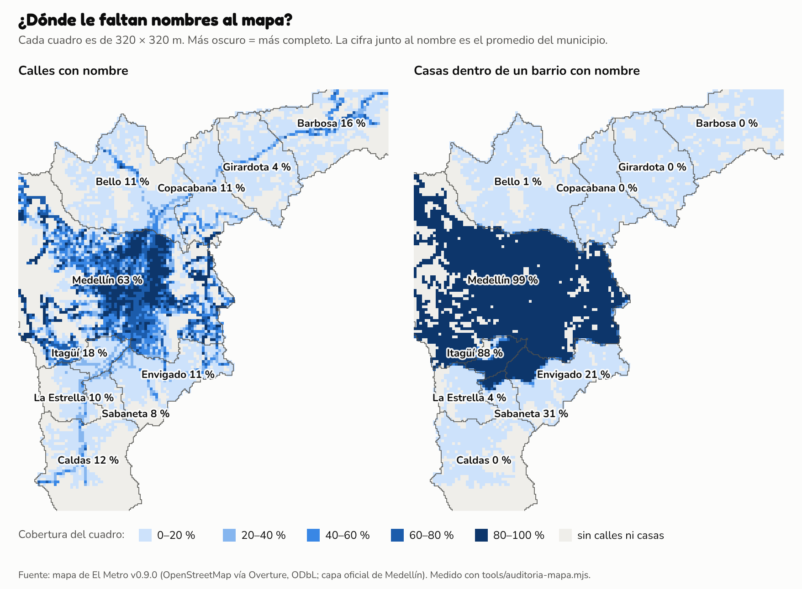
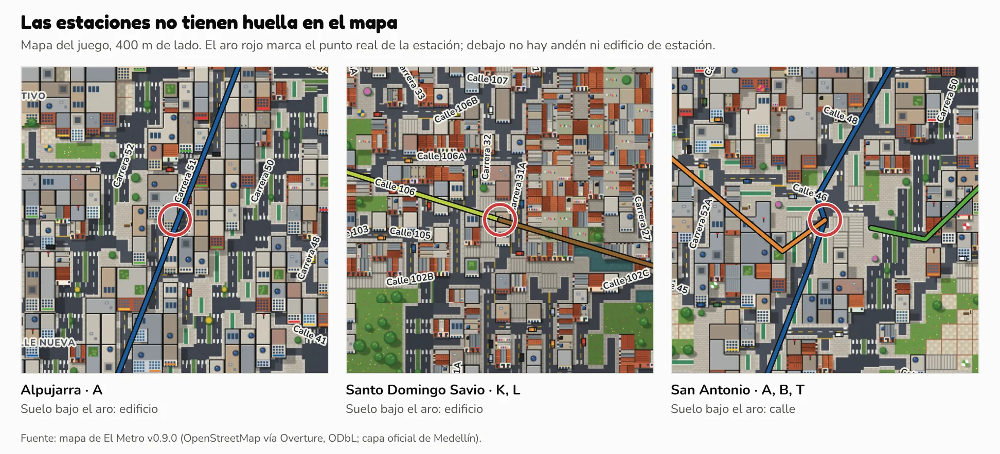
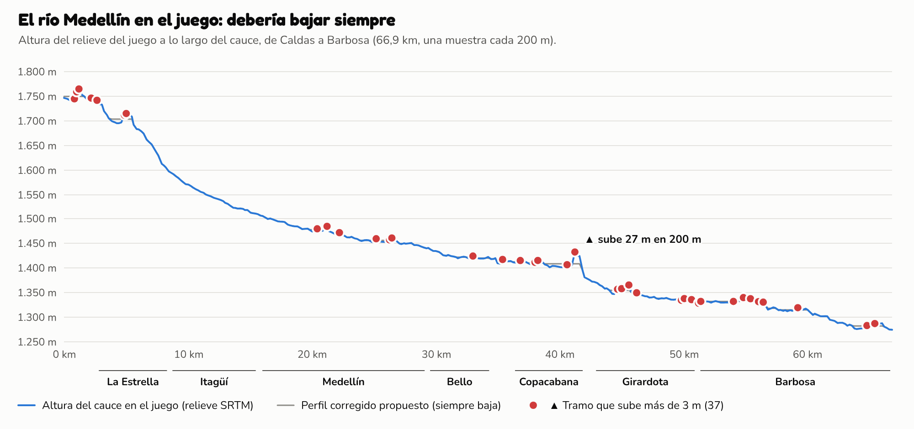
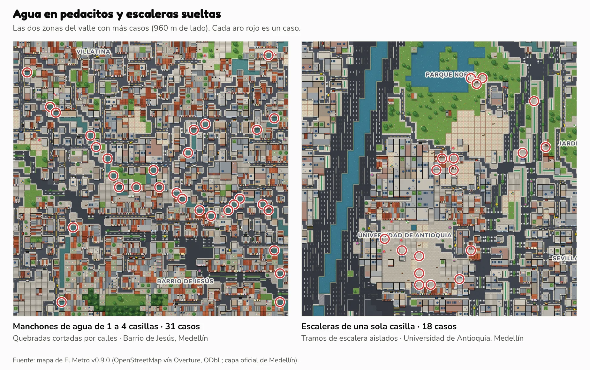
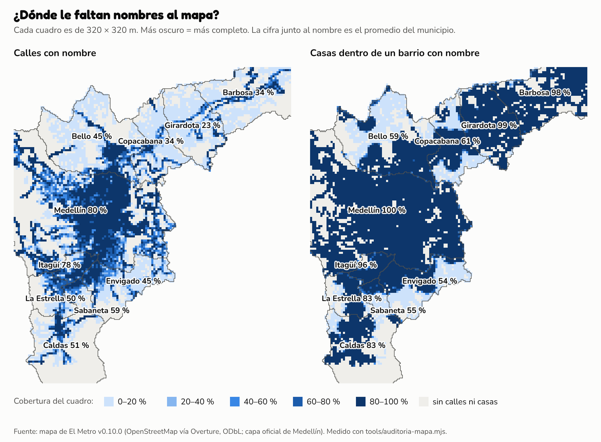
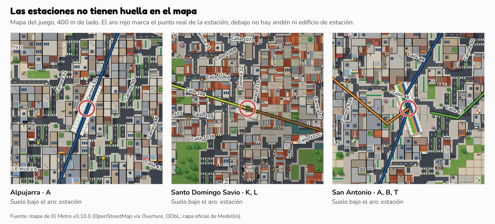
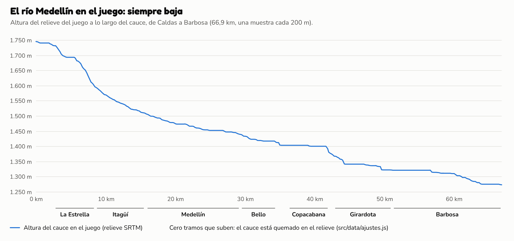

# Auditoría del juego y del mapa · v0.9.0

**Fecha:** 17‑nov‑2026 · **Versión:** v0.9.0 (publicada) · **Pedido del autor:** “Audita el videojuego, dame ideas y sugerencias y, en especial, analiza el mapa para seguirlo mejorando después”.

## Resumen
- **El juego está sano.**
  - 100 partidas automáticas con 0 errores y 0 errores de consola.
  - Carga en 0,6 s (en PC) y pesa 2,7 MB.
  - Menús accesibles: botones ≥ 44 px, con nombre y buen contraste.
- **Hay tres riesgos de rendimiento para celulares modestos:**
  1. la caché del mapa puede ocupar **~80 MB** de memoria de imagen;
  2. la panorámica lateral (metro y Metrocable) ocupa el hilo principal casi todo el tiempo;
  3. Ciudad Libre y el bus se congelan **0,2–0,3 s** al arrancar.
- **El mapa de Medellín está muy completo:**
  - el 99 % de las casas está dentro de un barrio con nombre;
  - el 63 % de las casillas de vía tiene nombre;
  - las calles coinciden con OpenStreetMap entre el 98 y el 100 %.
- **Lo que más falta en el mapa, medido:**
  - **fuera de Medellín e Itagüí** casi no hay barrios, y fuera de Medellín pocas vías tienen nombre (Bello: 1 % de casas con barrio y 11 % de vías con nombre);
  - **las 49 estaciones** de metro, tranvía y cable **no tienen huella** en el mapa, y dos caen sobre edificios;
  - **el río se corta 69 veces** y **sube 37 veces** cuando siempre debería bajar;
  - **las quebradas ocupan 29 km²**, más de cinco veces lo que ocupan el río y los lagos (5,3 km²), y hay **2.266 manchones** de agua sueltos;
  - **el tranvía de Ayacucho** pasa en un 24 % sobre casas.
- **Para repetir y comprobar cada mejora:** `node tools/auditoria-mapa.mjs` (nuevo) da todas las cifras del mapa de este informe.

## Método
| Qué | Cómo | Dónde quedó |
|---|---|---|
| Mapa | `node tools/auditoria-mapa.mjs --json salida.json --img docs/auditorias/img/2026-11-17`. Recorre las 5,3 millones de casillas con el propio juego en Chromium | Cifras de la sección 5 y las cuatro láminas |
| Rendimiento | Chromium sin GPU (como un celular sin aceleración), 412 × 860 px a 2×. Se miden 9 s por modo con el perfilador de CPU | Sección 1 |
| Balance | Partidas automáticas de 6 niveles por modo, con la misma semilla y el piloto o la IA interna de cada modo | Sección 2 |
| Código y seguridad | Conteo de líneas, peso por archivo y revisión de las entradas externas: guardado, invitaciones, red y archivos | Sección 3 |
| Accesibilidad | Revisión del DOM en inicio, Elige tu viaje, ajustes y Ciudad Libre: nombre de cada botón, tamaño táctil, contraste WCAG y letra mínima | Sección 4 |

> Las cifras de rendimiento sirven para **comparar modos entre sí**, no para prometer cuadros por segundo en un celular: falta medir en equipos reales.

## 1. Rendimiento y memoria
| Medida | Resultado | Lectura |
|---|---:|---|
| Carga hasta “listo” | 590 ms | Bien |
| Tamaño del HTML | 2.710 KB | Lo más pesado: relieve y mapa base (`valle.js`, 1.059 KB), arte (533 KB), ciudad (330 KB) y fuentes (139 KB). El código pesa 588 KB |
| Memoria JS tras cargar | 36 MB | Bien |
| Memoria de imagen de la caché del mapa | hasta **~80 MB** | **Riesgo.** Cada trozo de 640 m es un lienzo de 512 × 512 (1 MB) más su capa de luces de noche (otro MB), y la caché guarda 40 trozos (`10-map.js`). La capa de luces se crea también de día |
| Ciudad Libre a pie, en carro y bus | 60 cuadros/s; 30–34 % del tiempo en reposo | Bien |
| Arranque de Ciudad Libre y del bus | primer cuadro de 183–333 ms | Tirón visible: se construyen varios trozos en el mismo cuadro |
| Panorámica lateral (metro y Metrocable) | mediana 60 cuadros/s, percentil 95 a 30; **0,3–0,4 % en reposo** | **El modo más pesado:** el dibujo de capas (`layer`, `barrio`, `fg` en `23-lado.js`) satura el hilo principal |

## 2. Balance y contenido
**Contenido:** 9 modos y 186 niveles, 31 líneas y 160 estaciones, 20 logros, 48 postales, 8 capítulos en la ciudad y 11 clásicos, y 38 preguntas.

| Modo | Niveles | Ganadas por el bot (de 6) | Estrellas medias | Lectura |
|---|---:|---:|---:|---|
| Despacho | 12 | 6 | 2,8 | Fácil para la IA interna |
| Metrocable (gestión) | 30 | 6 | 3,0 | **Demasiado fácil** para la IA: puede necesitar más reto en los niveles altos |
| Conduce el metro | 38 | 5 | 1,0 | Razonable |
| Alimentadores | 9 | 4 | 1,2 | Razonable |
| Viaje en Metrocable | 6 | 5 | 0,0 | **Incoherencia:** se “gana” al llegar aunque el puntaje sea negativo (media −450), y la pantalla dice “¡Bien hecho!” con 0 estrellas |
| Bus | 35 | 1 | 0,3 | El piloto automático no busca ganar; no mide la dificultad |
| Metroplús | 8 | 1 | 0,3 | La IA interna casi no gana: revisar si es la IA o la curva de dificultad |
| Al volante | 32 | 0 | 0,0 | Igual que el bus: el piloto no mide la dificultad |

**Conclusión:** el bot sirve para encontrar errores, no para balancear. Para balancear hacen falta datos de jugadores reales (ver la idea 8).

## 3. Código y seguridad
- **Tamaño:** 5.087 líneas de JS en 34 archivos. Los más grandes son `30-conduce.js` (457 líneas, 56 KB), `10-map.js`, `36-libre.js` y `32-volante.js`.
- **Legibilidad:**
  - 354 líneas pasan de 300 caracteres, 45 pasan de 600 y la más larga tiene 1.183;
  - son difíciles de revisar y de comparar en Git;
  - sugerencia: partir solo las de más de 600 cuando se toque cada archivo, sin reescribir por reescribir.
- **Dato sin uso:** `VALLE_META.river` (248 puntos del río, solo de Acevedo a Barbosa) no lo usa ningún módulo. Se puede borrar o completar y usar para animar la corriente.
- **Pruebas:**
  - el autotest revisa datos, arte, álbum, ciudad, seguridad y maqueta, y se suman 100 partidas y el recorrido de la interfaz;
  - falta una prueba de **memoria** (trozos en caché) y una de **tiempo por cuadro** por modo.
- **Seguridad: bien.**
  - CSP estricta, HTML siempre escapado con `esc()`, guardado saneado (`Save.sanitize`), mensajes de red validados y sin `eval`.
  - **Pequeño riesgo:** `Net.unpack` (`06-net.js`) descomprime el código de invitación sin tope de tamaño. Un código malicioso pegado a mano puede inflarse a decenas de MB. Arreglo: leer el flujo con un tope de 64 KB.
- **Recordatorio:** la APK se firma con la clave de desarrollo que está en el repositorio. Antes de publicarla en una tienda hay que sacarla. Lo decide el autor.

## 4. Accesibilidad
- ✅ `lang="es"`, soporte de “reducir movimiento”, foco visible, y menús con botones ≥ 44 px, nombrados y con buen contraste.
- ⚠️ **Dentro de Ciudad Libre:**
  - el botón 🏃 (`#lbUp`) no tiene nombre para lectores de pantalla;
  - 4 botones miden 46 × 42 px (la meta es 44 × 44);
  - la línea del capítulo en el HUD va en letra de 11,5 px con contraste 3,9:1 (la meta es 12 px y 4,5:1);
  - el rótulo “abordar” va en 10 px.
- ⚠️ No hay **región `aria-live`**: los avisos (“Bajaste en San Antonio”, misiones) no se anuncian.

## 5. El mapa a fondo
Todas las cifras salen de `tools/auditoria-mapa.mjs` sobre el mapa de v0.9.0: 2.158 × 2.461 casillas de 20 m (43 × 49 km).

### 5.1 Nombres de calle y barrios por municipio


| Municipio | Vías con nombre | Casas dentro de un barrio | Agua dibujada |
|---|---:|---:|---:|
| Medellín | **63 %** | **99 %** | 11,1 km² |
| Itagüí | 18 % | 88 % | 0,4 km² |
| Sabaneta | 8 % | 31 % | 0,3 km² |
| Envigado | 11 % | 21 % | 0,8 km² |
| La Estrella | 10 % | 4 % | 1,5 km² |
| Bello | 11 % | 1 % | 6,2 km² |
| Copacabana | 11 % | 0 % | 1,9 km² |
| Girardota | 4 % | 0 % | 3,4 km² |
| Barbosa | 16 % | 0 % | 5,4 km² |
| Caldas | 12 % | 0 % | 3,7 km² |

- En Medellín faltan nombres sobre todo en las **laderas altas y los corregimientos**: vías sin nomenclatura oficial, senderos y servidumbres.
- **Bello** tiene la red más grande sin barrios: 108 mil casillas construidas. Es donde más se nota.

### 5.2 Estaciones y líneas


- **Las 49 estaciones** de metro, tranvía y cable no tienen casillas de estación. El tipo “estación” existe, pero tiene 0 casillas: la estación solo existe como ícono que pinta cada vista.
- **Alpujarra (A)** y **Santo Domingo Savio (K, L)** caen sobre casillas de edificio.
- **Trazos:**
  - metro A: 65 puntos en 24,9 km, 4 % sobre casas;
  - metro B: 22 puntos, 5 % sobre casas;
  - **tranvía T: 17 puntos, 24 % sobre casas**: corta las esquinas en vez de ir por la calle Ayacucho.
  - Los cables van en línea recta entre estaciones, como en la realidad.
- El tipo **“patio”** existe pero está vacío: no aparece el **patio‑taller del Metro en Bello**.

### 5.3 El río Medellín


- **Recorrido:** de Caldas a Barbosa, **66,9 km**, de **1.746 m a 1.274 m**. Baja 472 m, un 0,7 % de pendiente media: cifras coherentes con el valle real.
- **Continuidad:** el agua del río se corta **69 veces** (90 casillas):
  - 70 de esas casillas son **autopista**: al convertir los datos en casillas, la vía tuvo prioridad sobre el agua donde la autopista pisa el cauce y en los puentes;
  - 13 son avenida, 4 calle y 3 otras.
  - Hay solo 291 casillas de tipo “puente” en todo el valle.
- **Pendiente:** el cauce **sube más de 3 m en 37 tramos**. El peor está en Copacabana (km 41): **sube 27 m en 200 m**.
- **Por qué sube:**
  - el relieve viene de SRTM, un modelo de **superficie**: el radar mide la copa de los árboles, los puentes y los muros del canal, no el agua;
  - además, una celda de 80 m es más ancha que el cauce y mezcla el río con las autopistas y los taludes.
- **Arreglo:** el perfil gris de la lámina es una **regresión isotónica**, la curva que siempre baja y más se parece al relieve. Corrige como máximo 24 m.

### 5.4 Quebradas y escaleras


- **Agua dibujada:**
  - 5,3 km² de río y lagos y **29,4 km² de quebradas** (casillas “canal”);
  - una quebrada real mide pocos metros de ancho, pero a 20 m por casilla ocupa toda la casilla. Por eso el valle se ve más “mojado” de lo que es.
- **Fragmentos:**
  - hay **4.276 cuerpos de agua**, y **2.266 tienen de 1 a 4 casillas**. Son quebradas cortadas por calles, muchas de ellas cubiertas bajo la vía en la realidad;
  - la peor zona es Barrio de Jesús y Villatina, en el centro‑oriente, con 31 manchones en 960 m.
- **Escaleras:**
  - 4.364 casillas, de las cuales **332 son sueltas** (sin otra escalera al lado);
  - la zona con más es la Ciudad Universitaria de la U. de A. y el Parque Norte: 18 en 960 m. Allí son escalinatas del campus;
  - en las laderas, una escalera suelta parece un error de dibujo.

### 5.5 Relieve
- Va de 967 m (la bajada hacia el Cauca, en el borde occidental del mapa) a 3.127 m (lo más alto de las montañas que rodean el valle). El 8,3 % de las celdas tiene pendiente mayor al 45 %.
- La celda de 80 m (SRTM) basta para la panorámica. Se queda corta en las **laderas de los cables** y en la **Maqueta 2:1**, donde se notan escalones.

### 5.6 Lo que ya está bien (y no hay que romper)
- **Trazado de calles:** coincide con OpenStreetMap entre el 98 y el 100 % (auditoría del 17‑nov, a 20 m).
- **Capa de ciudad:**
  - 89.446 casillas corregidas con datos oficiales;
  - 502 barrios, 2.438 calles con nombre y 656 lugares.
- **Rótulos y HUD:** muestran barrio y calle; la Maqueta 2:1 usa el mismo mapa.

## 6. Hoja de ruta del mapa (con su meta medible)
Cada paso se comprueba volviendo a correr `node tools/auditoria-mapa.mjs` y comparando la cifra.

| # | Qué | Cómo y con qué fuente | Hoy | Meta | Esfuerzo |
|---|---|---|---|---|---|
| M1 | **Estaciones con huella** | Estampar andén y edificio de estación orientados con la línea. Fuente: andenes y estaciones de OSM (`railway=platform`, `building=train_station`) o un rectángulo del largo del andén | 0 de 49; 2 sobre edificios | 49 de 49; 0 sobre edificios | Bajo |
| M2 | **Río continuo** | Pintar como “puente” las casillas de vía que cruzan o pisan el cauce | 69 cortes | 0 cortes | Bajo |
| M3 | **Río que siempre baja** | “Quemar” el cauce en el relieve con la regresión isotónica de la lámina, al compilar los datos | 37 tramos suben; máximo 27 m | 0 tramos | Bajo |
| M4 | **Tranvía por su calle** | Trazo de OSM (`railway=tram`) con todos sus puntos | 24 % sobre casas | < 3 % | Bajo |
| M5 | **Patio‑taller de Bello** | Llenar el tipo “patio” con el polígono del patio (OSM `landuse=railway`) | 0 casillas | Visible y con nombre | Bajo |
| M6 | **Escaleras con sentido** | Quitar las sueltas que no tocan andén ni vía; unir las demás | 332 sueltas | < 50 | Bajo |
| M7 | **Quebradas a su tamaño** | Dibujar la quebrada como un hilo de 4–6 px dentro de un **retiro verde**. Donde va cubierta bajo la calle, una línea tenue | 2.266 manchones; 29,4 km² pintados de agua | < 300 manchones; −70 % de agua pintada | Medio |
| M8 | **Nombres de calle fuera de Medellín** | Nombres de OSM (ODbL), procesados fuera del juego desde un extracto de Geofabrik | 4–18 % | ≥ 60 % | Medio |
| M9 | **Barrios fuera de Medellín** | Capas de barrios de los POT municipales (geoportales). Si no hay, puntos `place=neighbourhood` de OSM con regiones de Voronoi recortadas al municipio, marcadas “aproximado” | Bello 1 %; Copacabana, Girardota, Barbosa y Caldas 0 % | ≥ 90 % | Medio |
| M10 | **Anchos reales de calle** | Malla vial de Medellín (campo `Ancho`, mediana 6,9 m) y `lanes`/`width` de OSM | Todas iguales por tipo | 3 clases por ancho; glorietas | Medio |
| M11 | **Relieve de 30 m** | Copernicus GLO‑30, también de superficie: hay que quemar el río igual | 80 m | 30 m en laderas de cables y Maqueta | Medio |
| M12 | **Alturas reales** | Pisos de las construcciones del catastro de Medellín | Por comuna | Por edificio en Medellín | Grande |

**Orden sugerido:**
1. **M1 a M6 en una sola sesión.** Son baratos, se notan mucho y no aumentan el peso del juego.
2. Después **M7**, el cambio visual más grande.
3. Por último **M8 y M9**, que necesitan datos de fuera y licencias por citar en `docs/FUENTES.md`.

## 7. Ideas y sugerencias para el juego
### Rápidas (una sesión cada una)
1. **Memoria del mapa:**
   - crear la capa de luces solo de noche;
   - ajustar la caché a la memoria del equipo (`navigator.deviceMemory`): 16 trozos con 2 GB o menos.
   - Meta: ≤ 32 MB de imagen en calidad baja.
2. **Arranque sin tirón:** construir los trozos con un presupuesto de 6–8 ms por cuadro y mostrar primero el trozo del jugador.
3. **Resultado coherente:** con 0 estrellas o puntaje negativo, decir “Llegaste” y dar un consejo concreto, no “¡Bien hecho!”.
4. **Accesibilidad en juego:**
   - nombre al botón 🏃;
   - botones de 44 px;
   - letra de 12 px o más y contraste de 4,5:1 en el HUD;
   - una región `aria-live` para los avisos.
5. **Tope al descomprimir invitaciones** (64 KB).

### Medianas
6. **Panorámica más liviana:** pre‑dibujar las capas lejanas (cerros y barrios del fondo) en lienzos aparte y solo desplazarlas.
7. **Mapa:** M1 a M7 de la hoja de ruta.
8. **Números del jugador, sin internet:**
   - guardar por nivel los intentos, los abandonos y las estrellas;
   - mostrarlos en un panel “Mis números”;
   - el autor puede pedirlos por QR para **balancear con datos reales**.
   - Cuidar la compatibilidad del guardado `elmetro.v1`: solo campos nuevos.
9. **“Direcciones paisas” (minijuego en Ciudad Libre):** un pasajero pide “Calle 10 con Carrera 43A” y hay que llegar.
   - Enseña la nomenclatura: las calles van de oriente a occidente y su número sube hacia el norte; las carreras van de norte a sur y su número sube hacia el occidente.
   - Usa los nombres de calle que ya tiene el mapa.
   - Al principio, solo en Medellín (63 % con nombre); M8 lo lleva al resto del valle.
10. **“Placas de lo poco conocido”:**
    - unos 30 puntos del mapa con un dato curioso y su **fuente citada**, por ejemplo una quebrada que corre cubierta bajo una avenida o el patio‑taller del Metro;
    - cada placa da una postal del álbum;
    - aprovecha el álbum y los 656 lugares que ya existen.

### Grandes
11. **Capa vectorial de OSM** para todo el valle: calles con nombre y ancho, glorietas y huellas de edificios. Se procesa en el PC del autor o en una GitHub Action, porque Geofabrik está bloqueado desde la nube. Antes hay que decidir cuánto peso se acepta.
12. **Maqueta 2:1 en Ciudad Libre** como vista opcional, y repintado con el encargo G‑100.
13. **Trozos en un Web Worker** con `OffscreenCanvas`: elimina los tirones de raíz.
14. **“Salida de patio” al amanecer:** nivel especial que empieza en el patio‑taller de Bello. Necesita M5.

## Actualización v0.10.0: lo que ya se hizo
Medido con `node tools/auditoria-mapa.mjs`. Con `--sin-ajustes` se reproduce el antes. Los ajustes viven en `src/data/ajustes.js` (`tools/mapa_ajustes.mjs`).

| Paso | Antes (v0.9.0) | Después (v0.10.0) |
|---|---:|---:|
| M1 · Estaciones con huella | 0 de 49 · 2 sobre edificios | **49 con techo** (48 con casillas de estación) · 0 sobre edificios |
| M2 · Cortes del río (Caldas–Barbosa) | 69 | **0** (88 puentes) |
| M3 · Tramos del río que suben más de 3 m | 37 (máx. 27 m) | **0** (1.339 esquinas del relieve quemadas) |
| M4 · Trazo del tranvía sobre casas | 24 % | **0 %** |
| M5 · Patio‑taller del Metro | 0 casillas | **463** (con balasto y vías) y los talleres del Ferrocarril de Antioquia |
| M6 · Escaleras que no conectan con nada | 32 | **1** |
| M8 · Vías con nombre | Medellín 63 %, Itagüí 18 %, Bello 11 %, Girardota 4 % | Medellín **80 %**, Itagüí **78 %**, Bello **45 %**, Girardota **23 %** |
| M9 · Casas dentro de un barrio | Bello 1 %, Caldas 0 %, Girardota 0 %, Barbosa 0 % | Bello **59 %**, Caldas **83 %**, Girardota **99 %**, Barbosa **98 %** (aproximados) |
| M7 · Manchones de agua | 2.266 | 2.266 (sigue pendiente) |





- **De dónde salen los nombres y barrios nuevos:** del mapa de Juega EnCicla v1.2, que usa la misma cuadrícula (OpenStreetMap vía Overture).
  - La capa oficial de Medellín sigue mandando; lo nuevo solo llena casillas que no tenían nada.
  - Ver `docs/auditorias/2026-11-17-auditoria-encicla-v1.2.md`.
- **Arreglos rápidos (sección 7) hechos:**
  - memoria del mapa;
  - arranque sin tirón;
  - “Llegaste, sin estrellas”;
  - accesibilidad en Ciudad Libre;
  - tope a las invitaciones.

## Cómo repetir esta auditoría
```bash
node tools/build.mjs
node tools/auditoria-mapa.mjs --json mapa.json --img docs/auditorias/img/AAAA-MM-DD   # cifras y láminas del mapa
node tools/test.mjs 100                                                               # 0 errores
```
*Láminas generadas con el propio juego. Datos del mapa © colaboradores de OpenStreetMap (ODbL) vía Overture Maps Foundation, capas oficiales de Medellín (ver `docs/FUENTES.md`) y relieve SRTM (NASA, vía AWS Terrain Tiles).*
