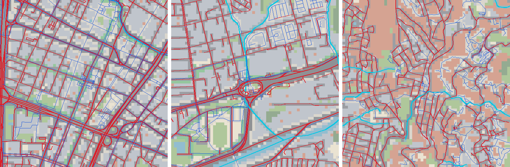

# ¿El mapa es igual a la ciudad real? · verificación contra OpenStreetMap

**Fecha:** 17‑nov‑2026 · **Versión del juego:** v0.6.0 · **Pregunta del autor:** “¿Está así mismo como en Google Maps, cada calle, cada vía, cada zona?”

**Respuesta corta:** el **trazado de las calles es el real** (medido), pero el **dibujo es una aproximación de 20 m por casilla**: los anchos, las curvas finas, las glorietas y los edificios no son exactos.

Se compara con **OpenStreetMap** porque es el mapa abierto equivalente. Los datos de Google Maps no se pueden copiar a un juego por licencia, y el proyecto prohíbe usar sus imágenes como base.

## Método
1. `node tools/osm-ventanas.mjs ventanas.json`: exporta ventanas de 60×60 casillas (1,2 × 1,2 km) del mapa del juego alrededor de tres estaciones, con su caja en lat/lon.
2. Se descarga cada caja de `api.openstreetmap.org/api/0.6/map` (tres consultas pequeñas, ODbL).
3. `python3 -I tools/osm_comparar.py ventanas.json DIR_OSM DIR_SALIDA`:
   - pasa las vías de OSM a la misma cuadrícula del juego (las fórmulas de `geoM`), con muestras cada 4 m;
   - mide en ambos sentidos.

## Resultados

| Zona | Calles reales (OSM) a ≤ 20 m de una vía del juego | … justo en la casilla | Vías del juego que existen en OSM (≤ 20 m) | Arterias | Tramos con nombre presentes (≥ 80 %) |
|---|---:|---:|---:|---:|---:|
| Centro · San Antonio | **100 %** | 91 % | **99,9 %** | 100 % | 214 de 214 |
| Niquía (Bello) | **98 %** | 87 % | **99,6 %** | 100 % | 62 de 62 |
| Santo Domingo Savio (ladera) | **100 %** | 86 % | **99,5 %** | — | 181 de 181 |

*Datos © colaboradores de OpenStreetMap, ODbL.*

## Qué es fiel y qué no
- ✅ **Cada calle y vía vehicular está, en su sitio:** todas las calles con nombre de las tres zonas.
- ✅ Parques, río, quebradas, laderas y relieve real (SRTM, 80 m).
- ⚠️ **Resolución de 20 m:**
  - una calle de 8 m se dibuja de 20 m;
  - las curvas salen en escalera;
  - la **glorieta de Niquía** queda como una mancha de asfalto (se ve clarita en OSM).
- ⚠️ **Vías pegadas en los datos:** autopista, avenida y viaducto junto al río venían fundidos. Desde v0.6.0 el dibujo los separa con barrera, bordillo o zona verde.
- ⚠️ **Carriles, separadores y cebras** los deduce el dibujo; no vienen en los datos.
- ❌ **Edificios:** son procedurales (lotes con techos, tanques y fachadas), no las huellas reales. OSM tiene **~7.200 edificios dibujados solo en la ventana de Santo Domingo**.
- ❌ **Alturas:** se estiman por comuna (centro y El Poblado altos; laderas bajas).

## Cómo llegar a “como en Google Maps” (Fase 1b del plan)
1. **Capa vectorial de OSM:**
   - ejes de vía con su ancho y su tipo, glorietas y curvas reales, y **nombres de calles**;
   - se procesa fuera del juego desde un extracto de OSM (Geofabrik) y se embebe en trozos comprimidos.
   - Desde esta nube Geofabrik está bloqueado; se puede hacer en el PC del autor o en una GitHub Action.
2. **Huellas reales de edificios** de OSM donde existan, con alturas estimadas (y reales si hay `building:levels`).
3. **Usos del suelo** de OSM (comercial, residencial, industrial, parques) para colorear zonas y elegir las casillas G‑60 a G‑63 de Gemini.
4. **Costo que hay que decidir:** todo el valle con edificios puede sumar varios MB. Hay que medirlo y elegir entre el detalle completo, solo el corredor del metro, o descargar por zonas.

## Actualización v0.7.0 · zonas corregidas con datos oficiales de Medellín
- **Hallazgo:** entre el **88 y el 97 %** de las casillas “andén” del mapa base estaban **dentro de manzanas catastrales**: eran lotes construidos sin huella de edificio en la fuente. Ese era el “adoquín sin sentido”.
- **Corrección:** se cambiaron 89.446 casillas como capa aparte (`src/data/ciudad.js`); el mapa base no se modifica:
  - en Medellín, con manzanas, lotes y espacio público oficiales;
  - en el resto, con la regla medida en Medellín (precisión del 88 al 97 % según los vecinos).
- **Calles con nombre:** 112.713 casillas de vía tienen nomenclatura oficial o el nombre de vía principal; 25.270, nombre popular.
- **Qué falta para “cada barrio”:** Bello y los municipios del norte y del sur sin capa abierta de barrios.
